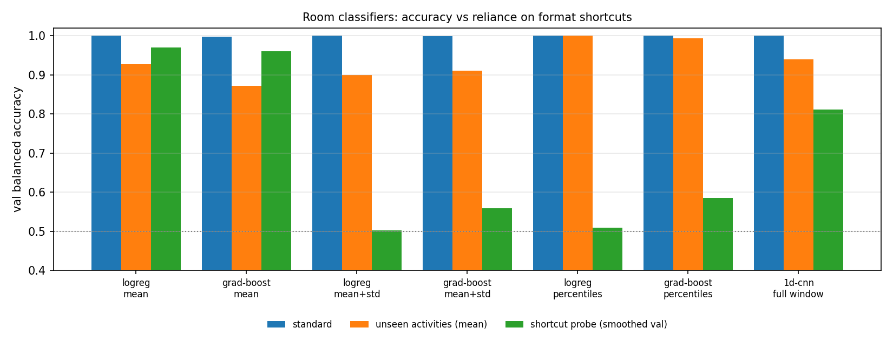

# Task 1 Stretch Models and Ablations (Milestone M8)

**Date:** 2026-10-18
**Command:** `python scripts/task1_ablations.py` (~2 min with GPU; `--skip-cnn`, `--plot-only`)
**Outputs:** `outputs/task1/ablations/` (`part1_models.csv`, `results.json`, `models_vs_shortcuts.png`)

---

## Why these experiments
The M5 baseline already scores 1.000, so a richer model cannot win on accuracy. The useful questions are:

1. **Which models lean on format shortcuts** instead of the room?
2. **Does the room signal survive** when the format gaps between the rooms are reduced?
3. **Does the random Room B validation split inflate results,** given that consecutive files are chunks of one recording?

## Part 1: models × features

**Features** (per-row normalized, so absolute scale is gone), computed over the 150 rows of a window for each of the 242 data subcarriers:
- mean (the M5 baseline)
- mean + standard deviation
- 10th/50th/90th percentiles

**Models:**
- logistic regression (C tuned on the dev holdout by log-loss)
- gradient boosting (scikit-learn defaults, class-balanced)
- a small 1-D CNN: 2 conv layers over time, with the 242 subcarriers as input channels; fixed recipe of 10 epochs, Adam, single seed

**Metrics:**
- **Standard:** trained and tested on all activities.
- **Unseen activities:** mean of the three M5/M7 transfer scenarios.
- **Shortcut probe:** the *same* standard model, scored on validation windows smoothed by a 5-wide moving average over subcarriers and over rows. Room B's row-to-row noise and spectral roughness are format cues. A model that uses them to recognise Room B starts calling smoothed Room B windows "A", so **recall B under the probe** measures shortcut reliance.

| Model | Features | Standard | Unseen activities (mean) | Probe: balanced acc | Probe: recall B |
|---|---|---|---|---|---|
| **logreg** | **mean** (C = 1000) | **1.000** | 0.926 | **0.969** | **0.939** |
| grad-boost | mean | 0.997 | 0.872 | 0.960 | 0.920 |
| logreg | mean + std (C = 1000) | 1.000 | 0.899 | 0.503 | **0.005** |
| grad-boost | mean + std | 0.999 | 0.911 | 0.559 | 0.117 |
| logreg | percentiles (C = 1) | 1.000 | **1.000** | 0.509 | **0.019** |
| grad-boost | percentiles | 1.000 | 0.993 | 0.585 | 0.171 |
| 1-D CNN | full window | 1.000 | 0.939 | 0.811 | 0.621 |

### Findings
1. **Every model scores ≥ 0.997 on the standard task.** Accuracy cannot separate them.
2. **Features that describe variation over time are format shortcuts.** With std or percentile features, smoothing turns almost every Room B window into "A" (recall B 0.005–0.17). These models recognise Room B mainly by its noisy rows, which is a property of how Room B's data was exported, not of the room.
3. **The best transfer score is a trap.** Percentile features score **1.000 on every unseen-activity test**, better than anything else. They transfer perfectly *because* Room B's row noise is the same whatever activity is happening. Without the shortcut probe, this model would have looked like the winner.
4. **The CNN sits in between.** It sees the full time series, so it can use row-to-row noise, and 38% of Room B windows flip under smoothing.
5. **The time-averaged mean spectrum (the M5 baseline) is the most robust choice.** Averaging over time removes most row noise, so smoothing changes little (recall B 0.939). Part of its remaining 6% drop is expected even for a perfect room model, since frequency smoothing also slightly distorts the real spectral shape.
6. **Gradient boosting never beats logistic regression** on transfer with the same features.

**Conclusion:** the M5 choice (mean spectrum + logistic regression) stays. Richer features and models do not improve the honest metric and mostly add format reliance.

## Part 2: harmonization (smoothing both rooms)
Both rooms are smoothed with the same moving average (width w over subcarriers and over rows). Then we rerun the format audit (AUC of each format statistic, dev windows), retrain the baseline, and retrain the format-only control.

| Format statistic (AUC, 0.5 = no info) | w = 1 (none) | w = 5 | w = 9 |
|---|---|---|---|
| mean amplitude | 0.998 | 0.998 | 0.998 |
| 99th percentile | 0.935 | 0.999 | 1.000 |
| zero fraction | 1.000 | **0.500** | **0.500** |
| integer fraction | 1.000 | 1.000 | 1.000 |
| frequency smoothness | 1.000 | 1.000 | 0.989 |
| time smoothness | 1.000 | 0.996 | 0.986 |
| CV over time | 1.000 | 0.857 | **0.699** |
| peak / mean | 0.998 | 0.973 | 0.906 |

| Validation | w = 1 | w = 5 | w = 9 |
|---|---|---|---|
| Baseline standard | 1.000 | 0.999 | 0.999 |
| sit+stand → walk | 0.860 | 0.880 | 0.940 |
| shared → room-only | 0.930 | 0.917 | 0.900 |
| room-only → shared | 0.989 | 0.971 | 0.937 |
| **Format-only control** | 1.000 | **1.000** | **1.000** |
| Format-only without scale statistics | 1.000 | 1.000 | 1.000 |

### Findings
- **Smoothing cannot close the format gap.** A few statistics fade (zero fraction to chance, variation over time to 0.70), but scale, integer values and smoothness still separate the rooms almost perfectly. The format-only control stays at 1.000 even without the scale statistics.
- **Room accuracy is unaffected** (≥ 0.999). Transfer moves in both directions (walking improves, the other two drop), so there is no clear gain.
- **What this means:** the format confound cannot be engineered away with the data we have, because Room B's raw CSI is not available. It stays a stated limitation. The robust conclusion comes from Part 1: which *models* depend on it.
- **Side note:** the integer-value statistic stays at 1.000 even after smoothing. Averages of 5 integers are multiples of 0.2, so they still look "integer-like" more often than Room A's interpolated values. This is a pure artifact, and the baseline's features ignore it.

## Part 3: contiguous Room B split
Room B files with consecutive numbers are chunks of one recording, so a random validation draw has neighbours in development (data inspection §6). As a robustness check, Room B validation is replaced by a **random contiguous block of 25 files per class**. The 2 files on each side of the block are dropped, and so are the 4 files with non-standard names. Room A keeps its official split. Baseline model.

| Split | Standard | sit+stand → walk | shared → room-only | room-only → shared | Transfer mean |
|---|---|---|---|---|---|
| Official random split | 1.000 | 0.860 | 0.930 | 0.989 | 0.926 |
| Contiguous Room B block | 0.999 | 0.880 | 1.000 | 0.984 | 0.955 |

**Finding:** room identification does not depend on neighbouring chunks being in development (standard 0.999 vs 1.000). The transfer numbers are similar or higher. The consecutive-chunks issue does not inflate the Task 1 results. It may still matter for the activity tasks (Tasks 2 and 3).

## Caveats
- The CNN is one architecture with one seed and no tuning. Gradient boosting uses defaults. The claims are about *what kind of signal* each model uses, not about their best possible accuracy.
- The shortcut probe is one specific perturbation (smoothing). Models could rely on other format cues the probe does not touch, such as integer values or the remaining spectral shape differences.
- Validation transfer sets are small (100–299 windows), as in M7.
