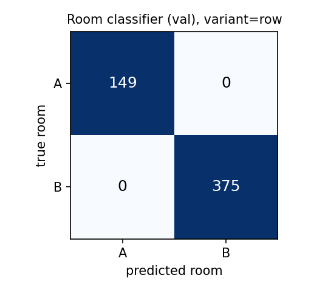
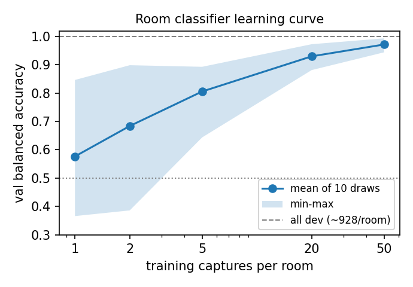

# Task 1 Baseline Results (Milestone M5)

**Date:** 2026-10-18 · **Window length:** 150
**Command:** `python scripts/task1_train_eval.py`
**Outputs:** `outputs/task1/L150/` (`metrics.json`, `model_selection.csv`, `predictions_val.csv`, `confusion_matrix_val.png`, `learning_curve_val.png`, `room_classifier.joblib`)

---

## 1. Method

| Part | Choice |
|---|---|
| Features | **Per-row normalized, time-averaged spectrum:** divide each row (packet) by its own mean, then average over the 150 rows → 242 numbers (14 DC/guard subcarriers removed) |
| Model | Standardize (fitted on dev) + logistic regression, class-balanced weights |
| Tuning | Feature variant fixed by design (`row`). `C` chosen on dev holdout by log-loss from {0.001 … 1000} → **C = 1000** (the top of the grid: the data is essentially linearly separable, so less regularization keeps helping) |
| Final fit | All development windows (928 A + 3,228 B) |
| Scored on | Validation: 149 A + 375 B windows (274 captures), used once |

## 2. Main result (validation)

| | Balanced accuracy | Accuracy | Recall A | Recall B | n |
|---|---|---|---|---|---|
| All activities | **1.000** | 1.000 | 1.000 | 1.000 | 524 windows |
| Shared activities (sit/stand/walk) | **1.000** | 1.000 | 1.000 | 1.000 | 299 windows |
| Capture level (mean probability) | **1.000** | 1.000 | 1.000 | 1.000 | 274 captures |

Every room/activity group is 100% correct. Confusion matrix: `[[149, 0], [0, 375]]`.

## 3. Controls: what does the 100% mean?

| Control | Result | Reading |
|---|---|---|
| **Format-only** (8 format statistics, no spectrum) | balanced **1.000** (shared: 1.000) | The rooms can be told apart perfectly **without any room physics**. A 100% room score alone proves nothing. |
| **Shuffled labels** (room labels permuted across dev captures, 20 runs) | balanced 0.44 ± 0.10 | At chance level. No leak through the pipeline, splits or features. |
| **Train sit+stand → test walk** | balanced **0.86** (recall A 1.00, B 0.72) | Walking changes Room B's spectrum enough that 28% of its windows look "not like B" to a model that never saw walking. |
| **Train sit+stand+walk → test room-only activities** (empty, lying / fall, sitdown, standup) | balanced **0.93** (A 1.00, B 0.86) | Mostly transfers, but 14% of empty/lying windows are misrouted. |
| **Train room-only activities → test sit+stand+walk** | balanced **0.99** (A 1.00, B 0.98) | Learned on completely different activities, the model still finds the room on the shared ones. |

## 4. Ablation: feature variant (validation, each at its own holdout-best C)

| Variant | Balanced acc | Shared balanced acc | Log-loss |
|---|---|---|---|
| `none` (raw mean amplitude, keeps scale) | 1.000 | 1.000 | 0.0006 |
| **`row`** (per-row normalized, **main**) | **1.000** | **1.000** | **0.0001** |
| `log` (log amplitude minus row mean) | 0.993 | 0.998 | 0.0162 |

Removing absolute scale (`row`) does not hurt; it is actually the most confident. Log compression costs a little.

## 5. Robustness: is the 100% overfitting, a bug or a shortcut?

| Check | Result | Reading |
|---|---|---|
| Train vs validation | 1.000 vs 1.000 | No train/test gap, so no classic overfitting |
| **Learning curve** (train on k captures per room, 10 random draws) | k=1: 0.58 · 2: 0.68 · 5: 0.81 · 20: 0.93 · 50: 0.97 · all (~1000): 1.00 | The task is **not** trivial in this feature space. It takes hundreds of captures to reach 100%. A blatant format shortcut (like loudness) would be learned from 1–2 captures. |
| **Nearest centroid** (no learning: closer to the A or B average fingerprint?) | 0.879 | The two rooms' average fingerprints are about as far apart (3.5) as a typical window is from its own room's average (3.4 for A, 4.2 for B). The rooms overlap; the linear model has to find specific subcarrier patterns. |
| **Edge subcarriers** (32 subcarriers next to band edges/guard bands, where format differences are largest) | 13% of features carry 15% of the weight; accuracy without them: **1.000** | The model does not lean on the edges. Its top weights are spread across the whole band. |
| **Leave-one-day-out** (Room A recorded on 9 days; hold out a whole day) | Room A recall on unseen days **0.991** (worst day 0.953); Room B val recall 1.000 throughout | The fingerprint survives new recording sessions. Validation shares days with training, so this is the stronger test. Room B has no timestamps and cannot be checked this way. |

**Conclusion of the checks:** no bug, no overfitting, no edge-subcarrier shortcut, and the fingerprint generalizes across Room A recording days. What remains unproven is how much of the separation comes from the room versus Room B's different export processing. The format-only control shows that format alone would be enough, but the learning curve shows our per-row normalized spectrum does **not** pick it up as an easy shortcut.

**Process note:** the first run used a model-selection rule that could also choose the feature variant, and it picked `none` (raw scale). That run's validation score was seen before the variant was fixed to `row`, as decided in the plan before any results. Both variants score 1.000 on validation, so the change did not select on validation results.

## 6. Interpretation (for the report)

1. **Room identification is solved at 100%** on validation windows and captures, including the activities both rooms share.
2. **The number is an upper bound inflated by format differences.** A model given only format statistics (scale, smoothness, integer values) also scores 100%. The two rooms were recorded in different sessions and exported through different processing pipelines, and with only two rooms we cannot separate "room" from "recording + processing".
3. **Evidence that the fingerprint is at least partly about the room and not only about activities:** a model trained only on activities that exist in one room still identifies the room on sit/stand/walk at 99%.
4. **The fingerprint is not activity-invariant.** Movement (walking) and different scenes (empty room, lying) shift Room B's spectrum, and a model trained on still activities misroutes up to 28% of those windows. This matters for Task 3, where the router sees target-room activities it was not trained on.
5. **Weak spot:** every error in the transfer controls is a **Room B window predicted as A**, never the reverse.
6. **Not overfitting:** the robustness checks (§5) show the accuracy needs a lot of training data, does not rely on edge subcarriers, and holds on unseen Room A recording days (99%).

## 7. Caveats
- Room B validation files have consecutive-chunk neighbours in development (see data inspection §6), which can make Room B results slightly optimistic.
- 7 Room A `sit` captures were dropped (< 20 full-band packets), so Room A validation has 24 sit captures.
- With C at the edge of the grid, the model is effectively unregularized. The choice barely matters: on the dev holdout, the `row` variant scores 0.998–0.999 balanced accuracy for every C ≥ 1 (`model_selection.csv`).

## 8. Next (M6)
The window-length study will need the controls to be informative: plot room balanced accuracy vs window length for (a) all activities, (b) shared activities, (c) format-only, (d) train-sit+stand → test-walk.
