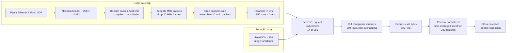
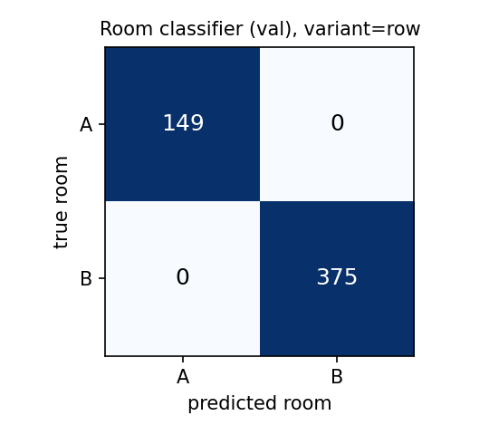
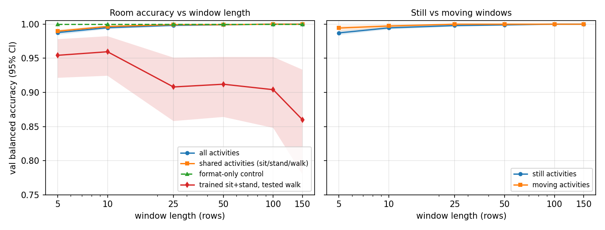
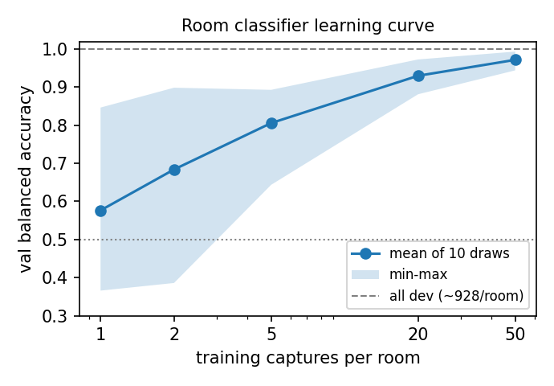
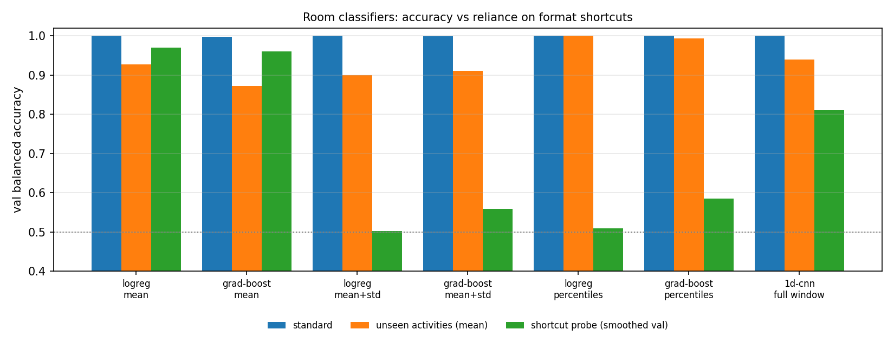

# Task 1 — Where Am I? Room Identification from WiFi CSI

*Report section for CS60055 Hackathon Challenge 2. All numbers are reproducible with the commands in §10. Supporting detail is in the milestone reports linked at the end.*

---

## 1. Task and summary

**Task.** Given one CSI window of 150 × 256 amplitude values, predict whether it was recorded in Room A (Experiment 2) or Room B (Experiment 3). The metric is accuracy on held-out validation captures.

**Summary.**
- **Result.** A per-row normalized, time-averaged amplitude spectrum with class-balanced logistic regression identifies the room with **100% accuracy** on the 524 validation windows (274 captures). This holds for every activity, including the three activities both rooms share.
- **Caveat.** This number is an **upper bound**. A model that sees only eight statistics describing the *data format* (scale, smoothness, integer values) also scores 100%. The two rooms were recorded in different sessions and exported through different pipelines, and with two rooms we cannot fully separate "room" from "recording and processing".
- **Supporting evidence.** Our controls show the classifier does carry real room information:
  - It is not trivially separable: 1 training capture per room gives 58%.
  - It survives held-out recording days: 99.1%.
  - It transfers to activities it never saw: 86–99%.
  - It is the model least dependent on format shortcuts among those we tried.

## 2. Data

| | Room A (Exp. 2) | Room B (Exp. 3) |
|---|---|---|
| Size | 3.5 × 4.5 m | 4.5 × 5 m |
| Format | raw `.pcap` (Nexmon CSI) | amplitude `.csv`, 500 rows × 256 |
| Activities | sit, stand, walk, sitdown, standup, fall | empty, lying, sit, stand, walk |
| Captures (dev / val) | 934 / 150 | 1,076 / 125 |

- **Sensing platform:** the same in both rooms (Asus RT-AC86U, BCM4366c0, Nexmon, channel 42, 80 MHz, 256 subcarriers).
- **Shared activities:** sit, stand and walk exist in both rooms. Every other activity exists in one room only. This matters for interpretation, because a model could identify the room by recognising a room-specific activity.

## 3. Preprocessing pipeline



### Why each choice

| Step | Choice | Reason |
|---|---|---|
| Decoding | Our own NumPy decoder for Nexmon's packed-float format (12-bit mantissas, shared 6-bit exponent, per-packet autoscale), written from the Nexmon CSI documentation | The BCM4366c0 does not store plain int16 I/Q. Decoded spectra are smooth across frequency (neighbour correlation ≈ 0.99), as a real channel should be. No authors' code was used. |
| Packet filter | Drop packets with ≥ 90% of their energy in subcarriers 128–191 | **71% of Room A packets** are 20 MHz frames (ACK/control) with no CSI on 192 of 256 subcarriers. Room B has almost none, so keeping them would hand the classifier a free room cue. |
| Short captures | Drop captures with < 20 valid packets (7 `sit` captures, one in validation) | Too few frames to represent a 4-second recording. |
| Room A length | Linear resampling in time of the valid packets (median 59 per capture) onto 150 rows | No capture has 150 valid packets. Resampling uses the true timestamps, because packets arrive irregularly. |
| Room B windows | Rows 0–149, 150–299, 300–449 | Deterministic. Windows never cross a capture. |
| Null subcarriers | Zero DC (0, 1, 255) and guard bands (123–133) in **both** rooms | They carry no channel information, only format differences. |
| Features | Divide each row (packet) by its own mean, then average over time | Removes per-packet gain (Nexmon autoscaling) and absolute scale, which differ between rooms for non-physical reasons. Time-averaging removes most of Room B's row-to-row noise. |
| Model | Standardize (fitted on dev) + logistic regression, class-balanced | Development has 3.5× more Room B windows. A linear model on a time-averaged spectrum is the hint from the brief, easy to inspect, and (§6) the least shortcut-prone. |

Duplicates and junk removed: one byte-identical `.pcap` (`stand65(1)`), 2 truncated packets, `.DS_Store` files and a stray `.png`.

## 4. Validation design

- **Unit of splitting = capture.** All windows of a capture stay on one side.
- **Room A validation:** the supplied `validation/` folder (25 per class; 24 `sit` after one short capture was dropped).
- **Room B validation:** 25 captures per class, drawn with `numpy.random.default_rng(42)` from naturally sorted capture IDs, frozen in `splits/room_b_validation.json`. The code refuses to redraw it silently.
- **Model selection** uses a development holdout only: 20% of dev captures per room and activity, seed 0. **Validation is scored once** and never used to choose anything.
- **Normalization statistics** are fitted on development data only.
- **Final counts:**
  - development: 928 Room A + 3,228 Room B windows
  - validation: 149 Room A + 375 Room B windows
- **Room B consecutive chunks.** Consecutively numbered Room B files are chunks of one longer recording. A random validation draw therefore has neighbours in development. A contiguous-block split (§7) shows this does not inflate the Task 1 result.

## 5. Results

### 5.1 Main result (validation)

| | Balanced accuracy | Recall A | Recall B | n |
|---|---|---|---|---|
| All activities | **1.000** | 1.000 | 1.000 | 524 windows |
| Shared activities (sit/stand/walk) | **1.000** | 1.000 | 1.000 | 299 windows |
| Capture level (mean probability) | **1.000** | 1.000 | 1.000 | 274 captures |

C = 1000 was chosen on the dev holdout by log-loss. Every room/activity group is 100% correct.



### 5.2 Room accuracy vs window length

Shorter windows are contiguous slices of each capture, so they cover less time in both rooms. In Room A one row ≈ 26 ms; Room B's rate is unknown, so length is given in rows. The protocol is repeated at each length, and the intervals are 95% capture-level bootstrap.



| Rows (Room A time) | 5 (0.13 s) | 10 | 25 | 50 | 100 | 150 (3.9 s) |
|---|---|---|---|---|---|---|
| All activities | 0.988 | 0.995 | 0.998 | 0.999 | 1.000 | 1.000 |
| Format-only control | 1.000 | 1.000 | 1.000 | 1.000 | 1.000 | 1.000 |
| Train sit+stand → test walk | 0.954 | 0.960 | 0.908 | 0.912 | 0.904 | 0.860 |

- **A fraction of a second is enough.** Most short-window errors are Room B windows called A.
- **Still vs moving makes no practical difference** (5 rows: 0.987 vs 0.994). This contradicts the brief's hint that still windows give the cleanest fingerprint.
- **Transfer to an unseen activity *worsens* with longer windows.** A fixed-C rerun shows that both window length and weak regularization contribute.

## 6. What does 100% mean? Controls and ablations

### 6.1 The format confound
Each statistic below describes the data format, not the room. Each one alone separates the rooms almost perfectly (development windows):

| Statistic | Room A | Room B | Separability (AUC) |
|---|---|---|---|
| Mean amplitude | 1007 | 351 | 0.998 |
| Exact-zero fraction | 0.000 | 0.002 | 1.000 |
| Integer-valued fraction | 0.69 | 1.00 | 1.000 |
| Frequency smoothness | 0.99 | 0.64 | 1.000 |
| Time smoothness | 0.90 | 0.04 | 1.000 |
| Variation over time (CV) | 0.18 | 0.71 | 1.000 |

A logistic regression on these eight statistics alone scores **1.000** on validation. Smoothing both rooms does not remove the gap: the format-only control stays at 1.000. Room B's raw CSI is not available, so this confound cannot be engineered away. **We therefore present 100% as an upper bound.**

### 6.2 Evidence that the classifier still learns the room

| Control | Result | Reading |
|---|---|---|
| Shuffled room labels (20 runs) | 0.44 ± 0.10 | Chance level: no leak through pipeline, splits or features |
| Train vs validation | 1.000 vs 1.000 | No overfitting gap |
| Learning curve (captures per room) | 1: 0.58 · 5: 0.81 · 20: 0.93 · 50: 0.97 | Not a blatant shortcut, which would be learned from 1–2 captures |
| Nearest centroid (no learning) | 0.879 | The rooms overlap; specific spectral patterns are needed |
| Without the 32 edge/near-guard subcarriers | 1.000 | No reliance on the most format-sensitive subcarriers |
| Leave-one-day-out (Room A, 9 recording days) | Recall A 0.991 (worst day 0.953) | The fingerprint survives new recording sessions |
| Train room-only activities → test sit/stand/walk | 0.989 | Recognises the room on activities it never saw |
| Train sit+stand → test walk | 0.860 (recall B 0.72) | Movement shifts Room B's fingerprint |
| Train sit/stand/walk → test room-only activities | 0.930 (recall B 0.86) | Mostly transfers |



### 6.3 Ablation: what helps and what does not

**Feature normalization** (logistic regression, validation balanced accuracy):
- raw mean amplitude: 1.000
- **per-row normalized: 1.000 (chosen)**
- log amplitude: 0.993

Removing absolute scale costs nothing.

**Richer features and models.** Every combination scores ≥ 0.997 on the standard task. They are compared instead on unseen-activity transfer and on a **shortcut probe**: the same model scored on validation windows smoothed over subcarriers and rows. Smoothing erases Room B's characteristic noise, so a model relying on it starts calling Room B "A".



| Model / features | Unseen activities | Probe | Probe recall B |
|---|---|---|---|
| **Logistic regression / mean (chosen)** | 0.926 | **0.969** | **0.939** |
| Gradient boosting / mean | 0.872 | 0.960 | 0.920 |
| Logistic regression / mean + std | 0.899 | 0.503 | 0.005 |
| Logistic regression / percentiles | **1.000** | 0.509 | 0.019 |
| Gradient boosting / percentiles | 0.993 | 0.585 | 0.171 |
| 1-D CNN / full window | 0.939 | 0.811 | 0.621 |

- **What does not help:**
  - Features describing variation over time (std, percentiles), a CNN on the full time series, and gradient boosting.
  - Percentile features reach a perfect transfer score only *because* they read Room B's row noise, which is the same for every activity. Under the probe they collapse.
- **What helps:**
  - **Time-averaging and per-row normalization.** Together they make the simple baseline the most robust model.

## 7. Robustness of the evaluation itself
- **Contiguous Room B split.** Validation replaced by a random contiguous block of 25 files per class, with 2 neighbouring files dropped on each side. Standard accuracy is 0.999 (official split 1.000), and transfer scores are similar. The consecutive-chunks issue does not inflate Task 1.
- **Process transparency.** Two choices were revised after a validation score had been printed:
  - The feature variant was fixed to the pre-planned per-row normalization after a selection rule had picked raw amplitude. Both score 1.000.
  - The Task 3 router's selection rule was enlarged. It picks the same variant.

  Neither revision changed a reported outcome.

## 8. Limitations
1. **Room vs recording/processing.** There are only two rooms, each recorded in its own sessions and exported differently, so room identity is confounded with format. 100% is an upper bound (§6.1).
2. **Room B cannot be tested across sessions.** It has no timestamps, so leave-one-day-out is only possible for Room A.
3. **Room B sampling rate is unknown.** Window lengths are compared in rows, not seconds.
4. **Resampling.** Room A windows are interpolated from a median of 59 valid packets, which makes them smoother in time than Room B. Time-averaged features are insensitive to this; models that read the time series are not (§6.3).
5. **Small transfer test sets** (100–299 windows), with wide intervals.
6. **Seven Room A `sit` captures were dropped,** so Room A validation has 24 `sit` captures.

## 9. Hand-off to Task 3: the room router

In Task 3 the room classifier routes windows, and results are compared under oracle routing vs predicted routing.

- **Rules check.** The router is trained on development windows of both rooms using **room labels only**. Its settings must not be chosen with target-room activity labels beyond the K support captures.
- **Default router (strict).** Settings are chosen with room labels only: per-row normalized spectrum, **slice averaging over 50-row slices, C = 1000**, trained on all development windows. It routes the validation windows with **100% accuracy**, so oracle and predicted routing should give near-identical Task 3 results.
- **Ablation router (activity-tuned).** 25-row slices, C = 1, chosen for transfer to unseen activities using development activity labels. It also scores 100% on routing. On unseen-activity tests its mean is 0.948, against 0.930 for the strict router.
- **API:**
  - `xroom.router.load_router(cfg, "strict")`
  - `xroom.router.route(windows, meta, mode="oracle" | "predicted", router=...)`

## 10. Reproducing

```bash
python scripts/build_windows.py --rebuild     # decode + windows (~30 s)
python scripts/audit_format.py                # format-leak audit
python scripts/task1_train_eval.py            # main result, controls, robustness
python scripts/task1_window_length.py         # window-length study
python scripts/task1_router_variants.py       # Task 3 routers
python scripts/task1_ablations.py             # models x features, harmonization, contiguous split
python -m pytest -q                           # 29 tests
```

**Supporting reports:**
- [data inspection](data_inspection.md)
- [preprocessing pipeline](preprocessing_pipeline.md)
- [baseline results](task1_baseline_results.md)
- [window length](task1_window_length.md)
- [router variants](task1_router_variants.md)
- [ablations](task1_ablations.md)
