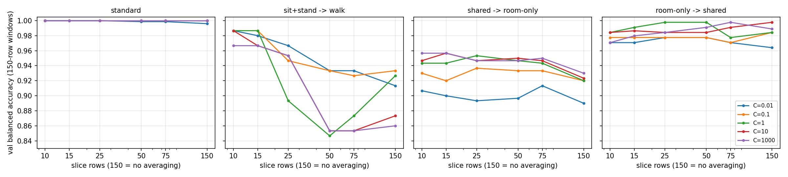

# Task 1 → Task 3: Router Variants (Milestone M7)

**Date:** 2026-10-18
**Command:** `python scripts/task1_router_variants.py` (~75 s)
**Outputs:**
- `outputs/task1/router_variants/` (`results.csv`, `summary.json`, `paired_vs_baseline_val.csv`, `router_variants_val.png`)
- `outputs/task1/router/` (`room_router.joblib`, `predictions_val.csv`)

---

## 1. Why
In Task 3 the room classifier becomes a **router**: it decides which room a window comes from, before activity recognition. It will see target-room activities it may never have been trained on. M6 found that the M5 model (150-row windows, C = 1000) transfers poorly to an unseen activity: trained on sit+stand, it gets only 0.86 on walking. M6 suggested two cheap fixes:

1. **Stronger regularization** (smaller C).
2. **Slice averaging:** cut each 150-row window into short slices, score every slice with a model trained on slices of that length, and average the slice probabilities.

## 2. Setup
- **Grid:** slice length s ∈ {150 (no averaging), 75, 50, 25, 15, 10} × C ∈ {0.01, 0.1, 1, 10, 1000}. Same per-row normalized spectrum features as M5.
- **The test unit is always a 150-row window**, which is what Task 3 will route.
- **Scenarios** (train activities → test activities):

  | Scenario | Train | Test |
  |---|---|---|
  | standard | all | all |
  | sit+stand → walk | still only | unseen walking |
  | shared → room-only | sit/stand/walk | unseen empty, lying, fall, sitdown, standup |
  | room-only → shared | room-specific activities | unseen sit/stand/walk |

- **Selection (development data only):**
  - Train on `dev_fold = train`.
  - The standard scenario is scored on `dev_fold = holdout`.
  - Transfer scenarios are scored on **all** dev captures of the test activities. Those activities are never trained on, so every one of those captures is unseen.
  - **Rule:** highest mean balanced accuracy over the three transfer scenarios, among variants with standard ≥ 0.995.
- **Validation** is reported for every variant, with a **paired capture-level bootstrap** (2,000 resamples) of each variant against the baseline.

**Process note:** the first run scored transfer scenarios on the holdout fold only. There, the walking test scored 1.000 for 27 of 30 variants, so it could not tell them apart. The rule was changed to use all unseen dev captures *after* that run's validation numbers had been printed. Both versions of the rule select the **same variant** (25 rows, C = 1), so the change did not alter the outcome.

## 3. Results

### Selected vs baseline

| | Standard | sit+stand → walk | shared → room-only | room-only → shared | Transfer mean |
|---|---|---|---|---|---|
| **Dev** baseline (150 rows, C = 1000) | 0.999 | 0.973 | 0.918 | 0.989 | 0.960 |
| **Dev** selected (25 rows, C = 1) | 1.000 | 0.982 | 0.962 | 0.992 | **0.978** |
| **Val** baseline | 1.000 | 0.860 | 0.930 | 0.989 | 0.926 |
| **Val** selected | 1.000 | 0.893 | 0.953 | 0.998 | **0.948** |

### Paired bootstrap on validation (difference vs baseline, 95% CI)

| Variant | sit+stand → walk | shared → room-only | room-only → shared |
|---|---|---|---|
| Regularization only (150 rows, C = 0.1) | **+0.073** [+0.033, +0.127] | −0.010 [−0.033, +0.010] | −0.005 [−0.029, +0.015] |
| **Selected** (25 rows, C = 1) | +0.033 [+0.000, +0.067] | +0.023 [−0.003, +0.057] | +0.009 [+0.000, +0.020] |
| 15 rows, C = 1 | **+0.127** [+0.060, +0.200] | +0.013 [−0.027, +0.057] | +0.002 [−0.016, +0.018] |
| 10 rows, C = 1 | **+0.127** [+0.060, +0.200] | +0.013 [−0.027, +0.053] | −0.005 [−0.029, +0.013] |

Test sizes on validation:
- walking: 100 windows (25 A + 75 B)
- room-only: 225 windows
- shared: 299 windows

## 4. Findings
1. **Both fixes help, and neither costs anything on the standard task.** Every variant keeps standard validation accuracy at 1.000, except the most regularized one with no slicing (0.996).
2. **Slice averaging with short slices helps most on unseen walking.** With 10–15-row slices, walking goes from 0.86 to **0.987** (+12.7 points, CI clearly above 0). Room B walking windows called A drop from 28% to 3%.
3. **Regularization alone also helps on walking** (+7.3 points at C = 0.1), but does nothing for the other two scenarios.
4. **The selected variant (25 rows, C = 1) is a modest, consistent improvement on validation:** transfer mean 0.926 → 0.948, with small positive differences in all three scenarios (two at the edge of significance).
5. **Dev cannot separate the top variants.** On dev, 25-row and 15-row slices at C = 1 are a tie (transfer mean 0.97848 vs 0.97841). Validation shows a clearly better walking score for 15 rows, but choosing 15 rows on that basis would mean selecting on validation. We keep the dev choice and report the plateau instead.
6. **Recall A stays ≥ 0.96 everywhere.** The remaining errors are still mostly Room B windows called A.

## 5. Decision
- **Task 3 router:** `RoomClassifier(variant="row", C=1, slice_rows=25)`, trained on all development 150-row windows of both rooms.
  - Saved as `outputs/task1/router/room_router.joblib`.
  - Validation predictions in `outputs/task1/router/predictions_val.csv` (standard validation balanced accuracy 1.000).
- **Task 1 headline result:** unchanged, still the M5 model. The router is an add-on for Task 3.
- **Still open:** whether Task 3's rules allow the router to be trained on all dev windows of both rooms, or only on what Task 3 may see (source labels + K support captures). Room labels are not activity labels, but this should be confirmed. If it is restricted, the router must be retrained under those rules. The code supports this; only the training set changes.

## 6. Caveats
- Validation transfer tests are small (100–299 windows). The bootstrap intervals are wide.
- These scenarios imitate "unseen activity". Task 3's real situation (a new room's activities with only K labeled captures) may behave differently.
- Format-confound caveats from M5 apply unchanged.
