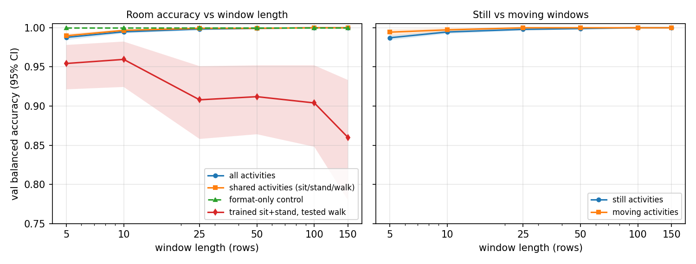

# Task 1 Window-Length Study (Milestone M6)

**Date:** 2026-10-18
**Command:** `python scripts/task1_window_length.py` (~2 min; `--plot-only` redraws the figure)
**Outputs:** `outputs/task1/window_length/` (`results.json`, `results.csv`, `room_acc_vs_length.png`)

---

## 1. Question
How much CSI does the room classifier need? We repeat the M5 protocol at window lengths **5, 10, 25, 50, 100 and 150 rows**.

## 2. How shorter windows are made
- Every capture is first turned into one sequence: Room A's full-band packets resampled to **150 rows** (~3.9 s, so ~26 ms per row), and Room B's file as is (**500 rows**, rate unknown).
- Windows are **contiguous, non-overlapping L-row slices** of that sequence. A shorter window therefore always means **less observation time** in both rooms.
- Windows per capture: Room A 150 ÷ L (1 at L = 100 or 150), Room B 500 ÷ L. All windows of a capture stay on its side of the split.
- At every L, the full M5 protocol is rerun: per-row normalized time-averaged spectrum, class-balanced logistic regression, C re-tuned on the dev holdout by log-loss, refit on all dev, scored once on validation.
- **95% intervals:** bootstrap over validation **captures** (1,000 resamples within each room), because windows of one capture are not independent.
- **Length is reported in rows, not seconds.** In Room A, 5 rows ≈ 0.13 s and 150 rows ≈ 3.9 s. Room B's sampling rate is unknown.

## 3. Results (validation balanced accuracy [95% CI])

| Rows | Tuned C | All activities | Shared (sit/stand/walk) | Still | Moving | Format-only | Train sit+stand → test walk |
|---|---|---|---|---|---|---|---|
| 5 | 0.1 | 0.988 [0.984, 0.991] | 0.990 [0.987, 0.992] | 0.987 [0.984, 0.990] | 0.994 [0.990, 0.998] | 1.000 | 0.954 [0.921, 0.978] |
| 10 | 0.1 | 0.995 [0.993, 0.997] | 0.997 [0.995, 0.998] | 0.995 [0.992, 0.997] | 0.997 [0.995, 1.000] | 1.000 | 0.960 [0.924, 0.982] |
| 25 | 1 | 0.998 [0.997, 1.000] | 0.999 [0.998, 1.000] | 0.998 [0.996, 1.000] | 1.000 | 1.000 | 0.908 [0.858, 0.951] |
| 50 | 1 | 0.999 [0.998, 1.000] | 0.999 [0.998, 1.000] | 0.999 [0.998, 1.000] | 1.000 | 1.000 | 0.912 [0.864, 0.952] |
| 100 | 1000 | 1.000 | 1.000 | 1.000 | 1.000 | 1.000 | 0.904 [0.848, 0.952] |
| 150 | 1000 | 1.000 | 1.000 | 1.000 | 1.000 | 1.000 | 0.860 [0.780, 0.933] |

- **Still** = empty, lying, sit, stand. **Moving** = walk, fall, sitdown, standup.
- Validation windows range from 16,970 (5 rows) to 524 (150 rows).
- The 150-row row reproduces M5 exactly, which serves as a consistency check.

## 4. Findings

1. **Very little data is needed.** Five rows (about 0.13 s in Room A) already identify the room 98.8% of the time. From 25 rows on, accuracy is ≥ 99.8%, and from 100 rows it is 100%. Longer windows average out more per-row noise, so the fingerprint gets cleaner.
2. **Short-window errors are almost all Room B called A** (L = 5: recall A 0.997, recall B 0.978). Room B's rows are noisier, which matches the format audit.
3. **Still vs moving makes no practical difference.** The slide hint suggests still windows give the cleanest fingerprint. Here moving windows are, if anything, slightly *easier* at 5 rows (0.994 vs 0.987, with barely overlapping intervals), and from 25 rows on both are ≥ 0.998.
4. **The format-only control scores 1.000 at every length.** The format gap between the rooms is visible in as few as 5 rows. Every number in this table is therefore an upper bound in the same sense as M5.
5. **Transfer to an unseen activity gets *worse* with longer windows.** Trained on sit+stand and tested on walking, the score drops from 0.95–0.96 (5–10 rows) to 0.86 (150 rows), and every error is a Room B walking window called A.
   - **Is it the window length or the tuned C?** C grows with length (0.1 → 1000), so we reran this control with C held fixed:

     | Rows | C = 0.1 | C = 1 | C = 1000 |
     |---|---|---|---|
     | 5 | 0.954 | 0.959 | 0.961 |
     | 25 | 0.933 | 0.908 | 0.918 |
     | 150 | 0.933 | 0.927 | **0.860** |

   - **Both contribute.** Longer windows transfer worse at every C. Weak regularization makes it much worse at 150 rows.
   - **Likely explanation:** long windows give very clean still-scene fingerprints, so an unregularized model fits details specific to still scenes, and walking disturbs those. Short, noisy windows force the model onto coarser features that survive movement.
   - **Caveat:** tuning C on the dev holdout optimizes accuracy on the *same* activities. It does not optimize transfer to unseen ones.

## 5. Implications
- **For the report:** room identity needs only a fraction of a second of CSI. But because of the format confound, this says as much about the recording pipeline as about the room.
- **For Task 3 (router):** the router must handle target-room activities it may not have been trained on. Two cheap options to test there:
  - a more regularized router (C ≈ 0.1), and
  - scoring a 150-row window by averaging the predictions of its short sub-windows (for example ten 15-row slices).

  Both are suggested by finding 5; neither is tested yet.

## 6. Caveats
- Lengths are in rows. Seconds are only known for Room A.
- Room A's maximum is 150 rows (its resampled sequence). Longer windows can only be studied in Room B.
- The C used at each length is tuned on the dev holdout. The fixed-C check above covers only the transfer control.
- All earlier caveats still apply: the format/session confound, and Room B's consecutive-chunk neighbours in development.
