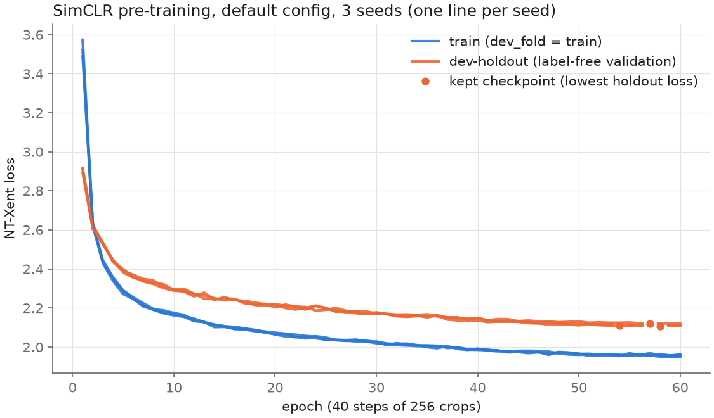
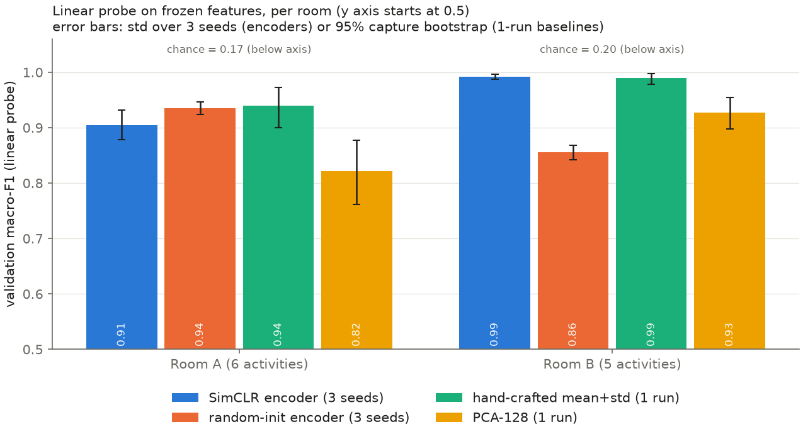
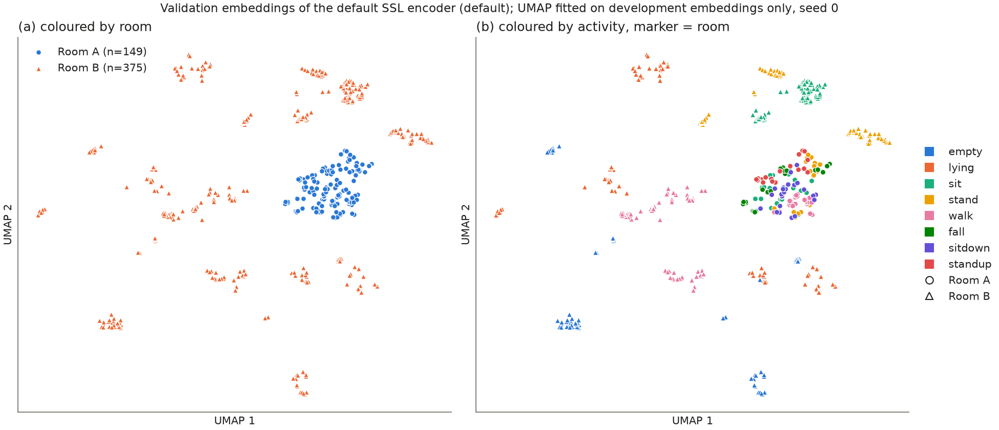

# Task 2 — Learn Without Labels: a Self-Supervised CSI Encoder

*Report section for CS60055 Hackathon Challenge 2. Every number below is copied from `outputs/task2/report_numbers.md`, which `scripts/task2_report_numbers.py` builds from the saved probe and ablation outputs. Reproduction commands are in §10.*

---

## 1. Task and summary

**Task.** Learn a CSI encoder **without activity labels**, freeze it, and test it with a **linear classifier** on its embeddings. The metric is **macro-F1** on validation.

**Summary.**
- **Result.** A 1-D CNN trained with SimCLR on development crops of both rooms reaches a per-room linear-probe macro-F1 of **0.905 ± 0.027 in Room A** (6 activities) and **0.992 ± 0.005 in Room B** (5 activities). That is a headline of **0.949 ± 0.016** (mean of the two rooms, 3 seeds).
- **Against the baselines.**
  - It clearly beats an untrained (random-init) copy of the same encoder in Room B (0.992 vs 0.856).
  - It does **not** beat random-init in Room A (0.905 vs 0.935). Room A is small and smooth, so random convolutional features already separate it well.
  - It is level with a strong hand-crafted baseline (0.965 headline).
- **What SSL adds.** The SSL embedding keeps its Room B score when the data format is perturbed (0.992 → 0.937). The hand-crafted features collapse under the same perturbation (0.989 → 0.260).
- **What helps** (ablations, compared on development data only):
  - per-row input normalization;
  - a higher contrastive temperature (τ = 0.5);
  - masked reconstruction (MAE). MAE is the only variant clearly above random-init in Room A on validation (0.957 ± 0.004).
- **What does not work yet.** Cross-room transfer. A probe trained on one room's sit/stand/walk scores at or below chance (0.33) in the other room, for every variant. The embedding is organised by room first. Task 3 must close this gap with per-room normalization and few-shot adaptation.

## 2. Data seen by the encoder

- **Input:** the Task 1 windows and sequences with the Task 1 preprocessing unchanged (`configs/task1.yaml`; see the Task 1 report §3). The encoder sees the **242 data subcarriers** (DC and guard subcarriers removed).
- **SSL training set:** development captures with `dev_fold == "train"`.
  - Room A: 150 resampled rows per capture.
  - Room B: 500 rows per capture.
  - 1,603 captures in total.
- **Label-free validation set:** the 401 `dev_fold == "holdout"` captures.
- **Never used:** validation captures. An assertion refuses them in the crop sampler (`ssl_data.assert_dev_only`), and a test injects one to check it fires.
- **Probing:** the fixed 150-row windows: 928 / 149 (A dev / val) and 3,228 / 375 (B dev / val).

## 3. Method

| Part | Choice | Why |
|---|---|---|
| Input normalization | Each row (packet) divided by its mean; then a per-subcarrier z-score whose statistics are fitted on **development rows only**, with the two rooms weighted equally. | Removes per-packet gain, a format cue (Task 1 §6). Equal room weights stop Room B's 3.5× more rows from dominating. |
| SSL samples | Random **contiguous crops** of 96–150 rows from dev-train sequences. A crop never crosses a capture. **Room-balanced** batches (≈ 50/50) of 256. | Room A has few captures. Balancing uses room identity only, never activity. |
| Augmentations | Crop + linear resize (60–100% of rows); Gaussian noise (σ = 0.1 × std); 1–3 subcarrier blocks zeroed (8–32 wide); 1–2 row blocks zeroed (5–20 rows); per-row gain jitter (σ = 0.1); **format jitter** (half the time a 3–7-row moving average, half the time added row noise). Each is applied with its own probability. | Crop, noise and subcarrier masking come from the brief. Format jitter targets the "smooth = A, noisy = B" shortcut. Preview: `outputs/task2/augment_preview.png`. |
| Encoder | 1-D CNN over time, subcarriers as channels: 4 × (Conv1d → BatchNorm → ReLU), channels 128-128-256-256, kernels 7-5-5-5, strides 1-2-2-2; global average pooling; linear to **d = 128**. **824,704 parameters.** | Accepts any length ≥ 32 rows. Fits the 4 GB GPU at batch 256. |
| Objective | **SimCLR NT-Xent**, τ = 0.2, projection head 128 → 128 → 64 (discarded after training). MAE-style masked reconstruction is an ablation: 50% of 10-row patches masked, MSE on masked rows. | The brief's hint. |
| Training | AdamW (lr 1e-3, weight decay 1e-4); 60 epochs × 40 steps; 3 warm-up epochs then cosine decay; mixed precision. About 4–6 min per run on an RTX 3050 laptop GPU. | |
| Checkpoint selection | The epoch with the **lowest SSL loss on dev-holdout crops**. This is label-free. | No activity label is read anywhere in SSL training; a test greps the SSL code. |

All settings are in `configs/task2.yaml`. They were **fixed before any probe was run**, and the default encoder uses them unchanged.



*Train and dev-holdout NT-Xent loss for the three seeds. Holdout loss falls from 2.893–2.915 to a best of 2.107–2.120 and flattens after about epoch 50; the kept checkpoints are at epochs 54, 58 and 57. The embeddings did not collapse: effective rank 67.7–69.2 of 128, per-dimension std 0.456–0.473.*

## 4. Evaluation protocol

- **Probe:** StandardScaler + class-balanced logistic regression on frozen embeddings.
  - C is tuned on development data only (`dev_fold` train → holdout, by macro-F1).
  - The probe is then refit on all development windows and **scored once on validation**.
  - Code assertions refuse validation rows in tuning or fitting.
- **Probe sets:**
  - **per-room A** (6 classes) and **per-room B** (5 classes); their mean is the **headline**;
  - **joint** (8 classes);
  - **cross-room preview** for Task 3: train on sit/stand/walk of one room's dev, test on the other room's val (chance 0.33).
- **Uncertainty:**
  - SSL and random-init: mean ± std over **3 seeds**;
  - single runs: 95% **capture-level bootstrap** intervals (validation captures resampled within each class);
  - capture-level macro-F1 is also reported (Room B: mean of its 3 windows' probabilities).
- **Baselines (same probe, same splits):**
  - random-init encoder (3 seeds);
  - hand-crafted features: per-row-normalized mean + std over time (484-d);
  - PCA-128 of normalized windows (fitted on dev; time averaged in pairs of rows to fit in memory).
- **Shuffled-label control:** labels permuted between captures. Every baseline drops to or below chance; for example, hand-crafted scores A 0.182, B 0.181, joint 0.100 against chance 0.167 / 0.200 / 0.125.

## 5. Results

### 5.1 Main result (validation macro-F1)

| Features | Room A (6 cl.) | Room B (5 cl.) | Joint (8 cl.) | Cross A→B | Cross B→A | Headline |
|---|---|---|---|---|---|---|
| **SimCLR, default (3 seeds)** | **0.905 ± 0.027** | **0.992 ± 0.005** | 0.944 ± 0.011 | 0.226 ± 0.033 | 0.228 ± 0.112 | **0.949 ± 0.016** |
| Random-init encoder (3 seeds) | 0.935 ± 0.011 | 0.856 ± 0.013 | 0.847 ± 0.013 | 0.167 ± 0.000 | 0.226 ± 0.063 | 0.895 ± 0.011 |
| Hand-crafted mean + std | 0.940 [0.90, 0.97] | 0.989 [0.98, 1.00] | 0.954 [0.93, 0.97] | 0.167 [0.17, 0.17] | 0.168 [0.17, 0.17] | 0.965 |
| PCA-128 | 0.822 [0.76, 0.88] | 0.928 [0.90, 0.95] | 0.814 [0.78, 0.85] | 0.390 [0.32, 0.46] | 0.243 [0.17, 0.32] | 0.875 |

**Per seed:**

| Run | Room A | Room B | Capture-level A / B |
|---|---|---|---|
| s0 | 0.905 [0.86, 0.95] | 0.995 [0.99, 1.00] | 0.905 / 1.000 |
| s1 | 0.932 [0.89, 0.97] | 0.995 [0.99, 1.00] | 0.932 / 1.000 |
| s2 | 0.878 [0.82, 0.93] | 0.987 [0.97, 1.00] | 0.878 / 0.992 |

**Per class, seed 0:**
- Room A: fall 0.94, sit 0.87, sitdown 0.83, stand 0.92, standup 0.92, walk 0.94. Sit-down is the hardest; its 5 misclassified windows went to stand-up (2), sit, stand and walk.
- Room B: all classes 0.99–1.00.



*Per-room validation macro-F1 of the linear probe. Error bars: std over 3 seeds for the encoders, 95% capture bootstrap for the single-run baselines. The y axis starts at 0.5; chance is 0.17 (A) and 0.20 (B).*

**Reading the result.**
- **Room B: SSL clearly helps.** The SSL encoder scores 0.992 against 0.856 for the same architecture untrained. Every seed beats every random-init seed.
- **Room A: SSL does not help.** Random-init features already score 0.935, and the SSL encoder scores 0.905 ± 0.027.
  - The dev-holdout probe gives the same tie (SSL 0.913–0.935, random-init 0.934–0.951), so this is not validation noise.
  - Room A has 928 dev windows, one per capture, and they are smooth because they are resampled from about 59 packets. The default augmentations and temperature remove some temporal detail that the six Room A activities need (§7).
- **Hand-crafted features are a strong reference** for within-room recognition (0.965 headline). The SSL embedding matches them in Room B, and §6.2 shows it does so far more robustly.

## 6. UMAP and controls

### 6.1 UMAP



*Validation embeddings of the default encoder. The scaler and UMAP were fitted on **development embeddings only** and validation was transformed (seed 0). (a) coloured by room; (b) coloured by activity, with marker shape for room.*

- **The embedding is organised by room first.** No region holds windows from both rooms.
- **Inside Room B it is organised by activity.** Each tight cluster holds a single activity. There are often several clusters per activity, likely separate recording sessions, since consecutive Room B files are chunks of one recording.
- **Room A forms a single cloud** with partial activity structure, matching its lower probe score.
- **Shared activities do not line up across rooms.** Sit, stand and walk from Room A sit far from the same activities in Room B. This is why the cross-room preview is at chance.

### 6.2 Controls

| Control | SimCLR (3 seeds) | Random-init (3 seeds) | Hand-crafted |
|---|---|---|---|
| Room probe accuracy (A vs B) | 0.999 ± 0.002 | 1.000 ± 0.000 | 1.000 |
| Format shift, Room A (clean → smoothed val) | 0.905 → 0.825 | 0.935 → 0.913 | 0.940 → 0.732 |
| Format shift, Room B (clean → smoothed val) | 0.992 → **0.937** | 0.856 → 0.208 | 0.989 → **0.260** |
| Cross-room A→B / B→A (chance 0.33) | 0.226 / 0.228 | 0.167 / 0.226 | 0.167 / 0.168 |

- **Format shift.** The probe is trained on clean development windows and scored on validation windows smoothed in time and frequency (the Task 1 "harmonize" transform), which removes Room B's row noise.
  - The hand-crafted Room B probe collapses to 0.260: it reads the noise texture rather than the activity.
  - The SSL embedding keeps 0.937, so its Room B activity information does not depend on that texture.
- **Room information is fully present** in every representation (0.999–1.000). This is expected given the format confound (Task 1 §6). It matters for Task 3: room must be normalized away, not just ignored.
- **Contiguous Room B split.** Validation is a contiguous block of 25 files per class, with 2 guard files on each side.
  - An SSL encoder pre-trained **without** that block scores 0.987 [0.97, 1.00] and 0.973 [0.95, 0.99] (2 seeds).
  - The default encoder, which saw the block unlabelled, scores 0.992.
  - Hand-crafted features score 0.943 [0.91, 0.97].
  - Neighbouring chunks therefore inflate Room B results only slightly.

## 7. Ablations: what helps and what does not

**Protocol.** Each variant changes one setting of the default config and is pre-trained with 2 seeds; the best two variants got a third seed. **Variants are compared on dev-holdout macro-F1 only.** Validation is reported, never used to choose. Source: `outputs/task2/ablations/summary.csv`.

| Variant | Dev-holdout A | Dev-holdout B | Val A | Val B | Val cross A→B / B→A |
|---|---|---|---|---|---|
| default (s0, s1) | 0.921 ± 0.011 | 0.988 ± 0.004 | 0.918 ± 0.019 | 0.995 ± 0.000 | 0.231 / 0.168 |
| no format jitter | 0.919 ± 0.000 | 0.989 ± 0.001 | 0.905 ± 0.011 | 0.992 ± 0.007 | 0.140 / 0.205 |
| no subcarrier masking | 0.925 ± 0.001 | 0.991 ± 0.003 | 0.953 ± 0.000 | 0.995 ± 0.004 | 0.094 / 0.266 |
| no crop + resize | 0.918 ± 0.015 | 0.986 ± 0.002 | 0.912 ± 0.009 | 0.992 ± 0.004 | 0.147 / 0.205 |
| crop + resize only | 0.912 ± 0.002 | 0.977 ± 0.005 | 0.946 ± 0.001 | 0.989 ± 0.000 | 0.179 / 0.334 |
| standardize only (no per-row step) | **0.870 ± 0.002** | 0.987 ± 0.003 | 0.871 ± 0.002 | 0.981 ± 0.011 | 0.191 / 0.358 |
| per-row + log | 0.915 ± 0.012 | 0.988 ± 0.001 | 0.935 ± 0.014 | 0.989 ± 0.004 | 0.217 / 0.231 |
| MAE instead of SimCLR | **0.956 ± 0.004** | 0.995 ± 0.002 | 0.956 ± 0.005 | 0.996 ± 0.006 | 0.208 / 0.238 |
| d = 64 | 0.897 ± 0.007 | 0.982 ± 0.004 | 0.914 ± 0.014 | 0.993 ± 0.002 | 0.293 / 0.185 |
| d = 256 | 0.951 ± 0.006 | 0.988 ± 0.005 | 0.916 ± 0.015 | 0.995 ± 0.000 | 0.186 / 0.232 |
| crops fixed at 150 rows | 0.929 ± 0.001 | 0.990 ± 0.005 | 0.925 ± 0.028 | 0.996 ± 0.002 | 0.180 / 0.274 |
| crops 64–150 rows | 0.899 ± 0.002 | 0.987 ± 0.005 | 0.914 ± 0.004 | 0.987 ± 0.007 | 0.194 / 0.317 |
| τ = 0.1 | 0.899 ± 0.004 | 0.979 ± 0.005 | 0.909 ± 0.034 | 0.987 ± 0.004 | 0.138 / 0.223 |
| τ = 0.5 | **0.960 ± 0.003** | 0.997 ± 0.000 | 0.922 ± 0.005 | 1.000 ± 0.000 | 0.311 / 0.288 |

**The two best variants with 3 seeds:**

| Variant | Dev-holdout mean (A, B) | Val A | Val B | Format shift A / B |
|---|---|---|---|---|
| default (τ = 0.2) | 0.9543 (2 seeds) | 0.905 ± 0.027 | 0.992 ± 0.005 | 0.825 / 0.937 |
| τ = 0.5 | **0.9776** | 0.923 ± 0.004 | 0.998 ± 0.003 | 0.877 / 0.971 |
| MAE | 0.9768 | **0.957 ± 0.004** | 0.993 ± 0.007 | **0.955 / 0.961** |

**What helps and what does not.**
1. **Per-row normalization is the most important input choice.** Without it, Room A drops from 0.921 to 0.870 (dev-holdout). Adding a log step neither helps nor hurts.
2. **Temperature matters.** τ = 0.1 / 0.2 / 0.5 give Room A 0.899 / 0.921 / 0.959 on dev-holdout. A softer contrastive target keeps more of the fine distinctions between Room A's activities.
3. **MAE is as good as the best SimCLR on development data.** It is the only variant clearly above random-init on Room A validation: its worst seed, 0.952, beats random-init's best, 0.948. It is also the most robust to the format shift.
4. **No single augmentation is critical.** Removing any one moves dev-holdout by ≤ 0.01. The format jitter does not measurably add format-shift robustness (Room B shift 0.919 without, 0.937 with; 2–3 seeds). The robustness comes from SSL training itself, compare random-init's 0.208.
5. **No variant makes cross-room transfer work.** Every setting scores 0.094–0.358 against chance 0.33. Self-supervision on both rooms does not by itself produce room-invariant activity features.

**τ = 0.5 vs MAE on validation.** By the rule fixed in advance (highest dev-holdout mean), τ = 0.5 is the label-tuned choice. It gains on dev-holdout Room A (0.959) but not on validation Room A (0.923), so Room A's supplied validation folder behaves differently from its dev-holdout captures. MAE ties it on development data (0.9768 vs 0.9776 dev-holdout mean). It is reported, not promoted: choosing between the two by validation score would be validation tuning.

## 8. Limitations

- **Room A's gain is not established.** The default encoder does not beat random-init in Room A. MAE does, but it was not selected by a validation-free rule. With 25 validation windows per class, differences of about 0.02 macro-F1 are 2–3 windows per class.
- **Validation and dev-holdout disagree in Room A** for SimCLR τ = 0.5 (0.923 vs 0.959). The supplied Room A validation folder may differ from the development captures, for example in recording session. We cannot test this without metadata.
- **Room B scores are near the ceiling** (0.99). The contiguous-block check shows only a small inflation (0.973–0.987 with the block held out of SSL). Clusters per recording session in the UMAP suggest Room B validation is still easier than a new session would be.
- **The rooms are separable by format** (Task 1 §6). Every representation encodes room perfectly. The format-shift probe shows the SSL encoder relies less on format texture than hand-crafted features do, but it cannot prove it relies on none.
- **Room-balanced batches use room identity.** This is not an activity label, but it is a source of information beyond the raw signal; we state it here.
- **No supervised upper bound** was trained (optional in the PRD). Time went to debugging Room A instead.
- **Ablations use 2 seeds** (3 for the top two). Differences below about 0.01 are within seed noise.

## 9. Hand-off to Task 3

- **API:**
  ```python
  from xroom.config import load_task2_config
  from xroom.encoder import load_encoder, embed
  cfg = load_task2_config()
  enc = load_encoder(cfg)            # outputs/task2/default
  z = embed(enc, windows)            # raw (n, T, 256) amplitudes -> (n, 128); applies the saved dev normalization
  ```
  It is deterministic in eval mode, uses the GPU if available, and accepts any window length ≥ 32 rows.
- **Default encoder (label-clean):** `simclr_s0`, trained with the default config. The seed (0) was fixed in advance, and the checkpoint was chosen by dev-holdout SSL loss (epoch 54). **No activity labels were used for its training or for choosing its settings**; see `outputs/task2/default/PROVENANCE.md`, written by `scripts/task2_publish_default.py`.
- **Label-tuned variants** were chosen or compared with development activity labels of both rooms: `abl_tau_0.5_s*`, `abl_method_mae_s*` and the other `abl_*` runs. Under the Task 3 rules they may be reported only as ablations, never as the Task 3 default. This is the same rule as the Task 1 strict router.
- **What Task 3 should expect.**
  - Within-room prototypes should work well; Room B classes separate almost perfectly.
  - Cross-room transfer starts at chance. Per-room normalization of embeddings (centring each room's embeddings) and the K support captures are needed.

## 10. Reproducing

```bash
python scripts/build_windows.py --rebuild              # Task 1 caches (~30 s)
python scripts/task2_augment_preview.py                # augmentation sanity figure
for s in 0 1 2; do python scripts/task2_pretrain.py --run simclr_s$s --seed $s; done   # ~4 min each
python scripts/task2_probe.py --baselines-only         # hand-crafted, PCA, random-init
python scripts/task2_probe.py --baselines-only --shuffle-labels
python scripts/task2_probe.py --encoder simclr_s0 simclr_s1 simclr_s2 --summary simclr_default
python scripts/task2_publish_default.py                # label-clean default encoder for Task 3
python scripts/task2_figures.py                        # reports/figures/task2_*.png
python scripts/task2_ablations.py                      # 13 variants x 2 seeds + contiguous check (~2 h)
python scripts/task2_ablations.py --only tau_0.5 method_mae --seeds 2 --skip-contiguous
for v in tau_0.5 method_mae; do python scripts/task2_probe.py --encoder abl_${v}_s0 abl_${v}_s1 abl_${v}_s2 --summary $v; done
python scripts/task2_probe.py --encoder abl_aug_no_format_s0 abl_aug_no_format_s1 --summary aug_no_format
python scripts/task2_report_numbers.py                 # every number in this section
python -m pytest -q
```

**Supporting files:** spec [PRD](../docs/PRD_Task2_Self_Supervised_Encoder.md); gated tracker with the results and decisions logs [tasks_task2.md](../docs/tasks_task2.md); [AI use and contributions](../docs/ai_use_and_contributions.md).

**AI use.** The Task 2 code, tests, runs and this section were produced with Claude Code (Anthropic Claude Opus 5.5) at Abhinav's direction, milestone by milestone; see the disclosure file.
